---
tags:
  - htb
  - sherlock
  - easy
  - post
urls:
---
---
# HTB Sherlock - Whisper Writeup

> **Scenario:** The SOC team received an alert on 21st January 2025 about suspicious activity originating from an employee's system (Alpha). Alpha was not authorized to engage in any offensive hacking activities within the network. The Incident Response (IR) team quickly acted, isolating the system so you can perform a thorough triage and investigation to determine the scope of the breach and potential impact on the network.

# QUESTIONS

1. What is the hostname of the company computer involved in the unauthorized activity?

**Answer:** `HELPDESK`

Parsing the `SYSTEM` registry hive with `RECmd.exe` to retrieve the hostname:

```powershell
.\RECmd.exe -f "C:\ad\Whisper\C\Windows\System32\config\SYSTEM" --kn ControlSet001\Control\ComputerName\ComputerName --nl false
```

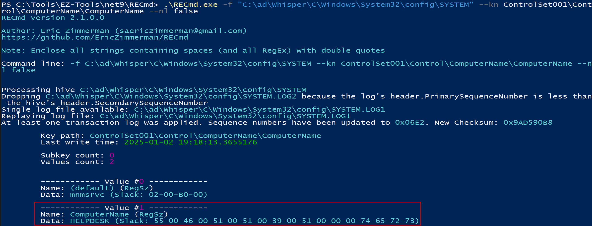

The `mnmsrvc` entry is a leftover from the old NetMeeting Remote Desktop Sharing service.

2. What is the IP address associated with the machine?

**Answer:** `192.168.159.199`

```powershell
.\RECmd.exe -f "C:\ad\Whisper\C\Windows\System32\config\SYSTEM" --kn "ControlSet001\Services\Tcpip\Parameters\Interfaces\{005fa5b2-3d9d-47e8-a4c5-e765a20d2bc1}" --vn DhcpIPAddress --nl false
```

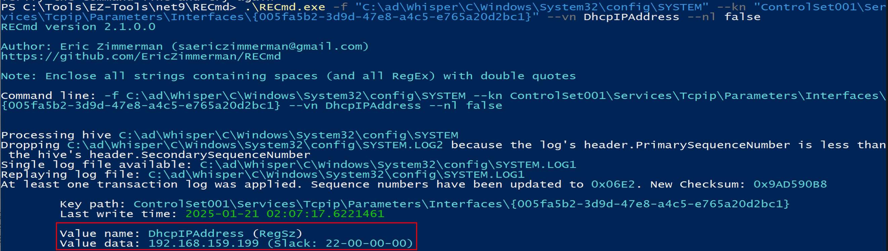

3. What is the Security Identifier (SID) of the computer involved in the incident?

**Answer:** `S-1-5-21-953115734-2025219997-3674921352`

The last 4 bytes represent the last part of the local `SID`:

```powershell
.\RECmd.exe -f "C:\ad\Whisper\C\Windows\System32\config\SAM" --kn "SAM\Domains\Account" --vn V
```

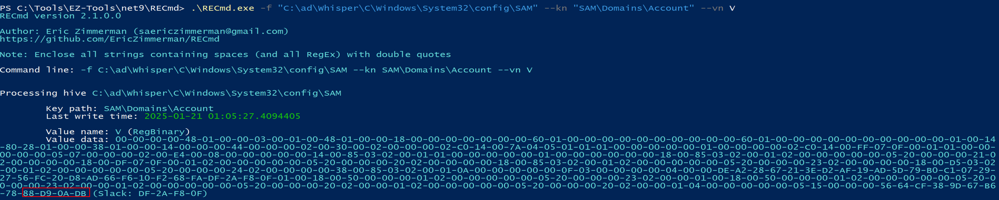

Reversing the endianness in the programmer calculator:

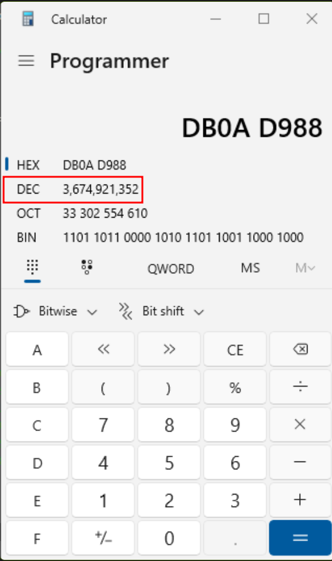

Then comparing it to the present SIDs

```powershell
.\RECmd.exe -f "C:\ad\Whisper\C\Windows\System32\config\SOFTWARE" --kn "Microsoft\Windows NT\CurrentVersion\ProfileList"  --nl false
```

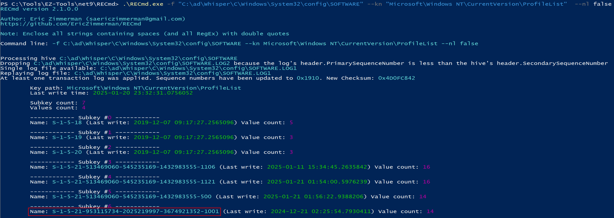

4. What was the timezone setting of the machine?

**Answer:** `Pacific Standard Time`

```powershell
.\RECmd.exe -f "C:\ad\Whisper\C\Windows\System32\config\SYSTEM" --kn "ControlSet001\Control\TimeZoneInformation"  --vn TimeZoneKeyName --nl false
```

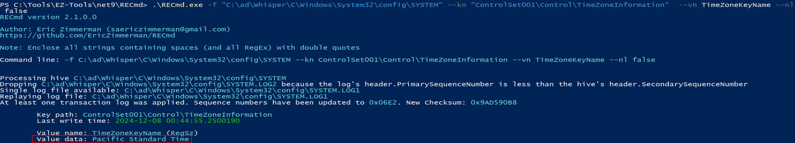

5. Which tool did the attacker use to escalate privileges and extract sensitive credentials from the system?

**Answer:** `mimikatz.exe`

Inside the `PREFETCH` folder there are two instances of `mimikatz.exe`:

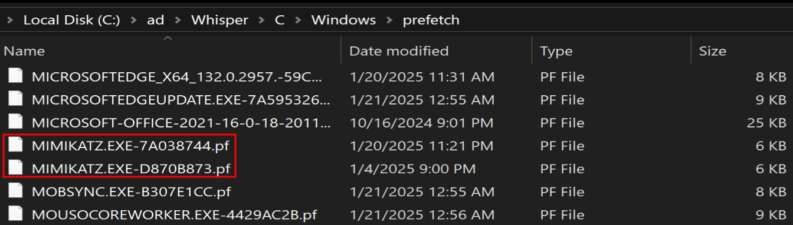

6. What is the timestamp of the last execution of the credential extraction tool on the system used by the attacker?

**Answer:** `2025-01-21 00:21:41`

Inside `.pf` files information such as last execution, run count, what files and directories the executable loaded is present:

```powershell
.\PECmd.exe -f 'C:\ad\Whisper\C\Windows\prefetch\MIMIKATZ.EXE-7A038744.pf'
```

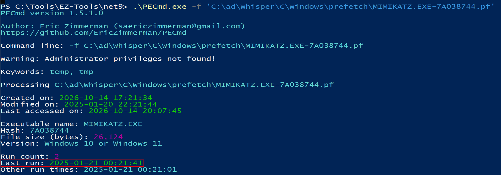

7. What is the timestamp when the attacker first downloaded the credential extraction tool onto the system?

**Answer:** `2025-01-21 00:20:15`

The `usn journal` records all changes made to a NTFS volume, providing plenty of information related to file creation, parsing it with `MFTECmd.exe`:

```powershell
.\MFTECmd.exe -f "C:\ad\Whisper\C\`$Extend\`$J" --csv C:\ad\Whisper\ --csvf usnjournal.csv
```

Filtering by `mimikatz` and `FileCreate` in `Timeline Explorer` shows the instance the tools drops to the system:

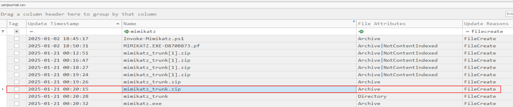

8. After using the previously mentioned tool, the attacker downloaded a script to scan the domain controller. What is the URL from which the attacker downloaded this script?

**Answer:** `https://mega.nz/file/I31zBZTb#H5aUJamEj2xMroi9baoTKCMjQF1jiV8TK9gbjoNGgkw`

From the previous questions it's known that the user performing malicious actions is `Alpha`,  the `HISTORY` file inside the path `C\Users\Alpha\AppData\Local\Microsoft\Edge\User Data\Default` holds information related to Microsoft Edge usage. The `downloads` table holds all the downloads performed:

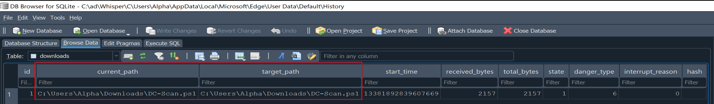

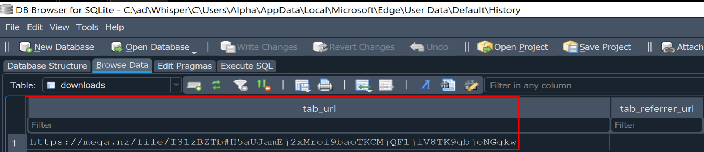

9. What is the filename of the script? (Format - Full path of file, starting with drive letter)

**Answer:** `C:\Users\Alpha\Downloads\DC-Scan.ps1`

10. What is the timestamp indicating when the attacker deleted the script after it was downloaded?

**Answer:** `2025-01-21 01:27:47`

Filtering the `USN Journal` for `DC-Scan.ps1` and `FileDelete|Close` returns the deletion time:

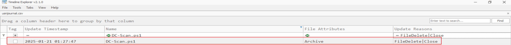

11. What is the name of the shared file that the attacker accessed?

**Answer:** `\\CYBERUP\Users\Administrator\Desktop\Top-Secret\Secret.xlsx`

The `Recent` folder inside `C\Users\Alpha\AppData\Roaming\Microsoft\Windows\` holds recently accessed folders and files:

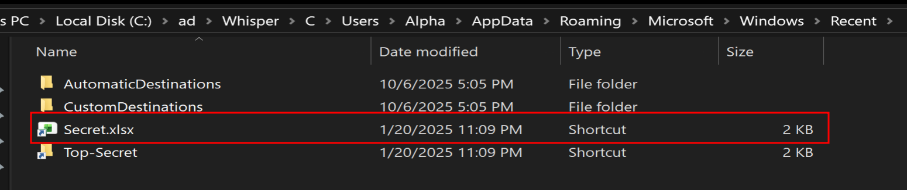

The properties of the file reveal the full path:

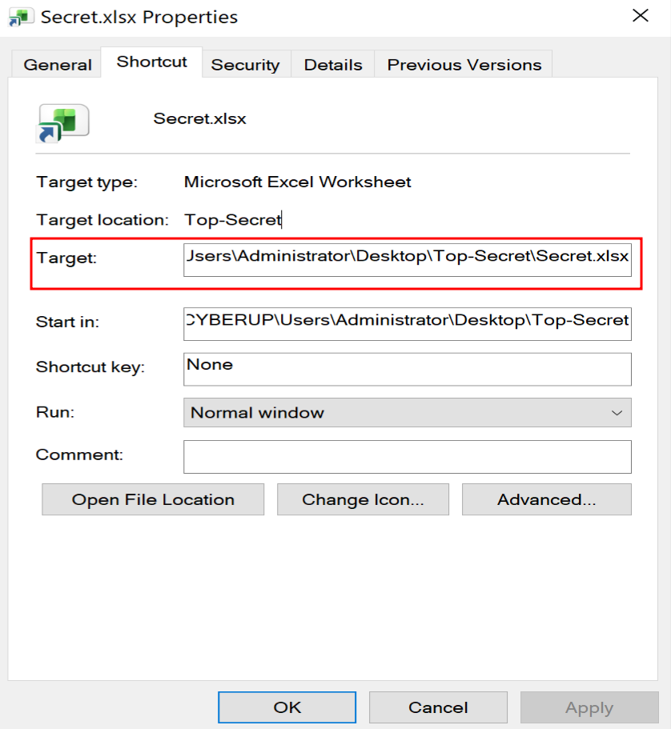

12. To persist, the attacker created a new user account. What is the SID of the newly created account?

**Answer:** `S-1-5-21-953115734-2025219997-3674921352-1002`

The `Admin` account was created at `01:02:00`:

```powershell
.\RECmd.exe -f "C:\ad\Whisper\C\Windows\System32\config\SAM" --kn "SAM\Domains\Account\Users\Names" --nl false
```

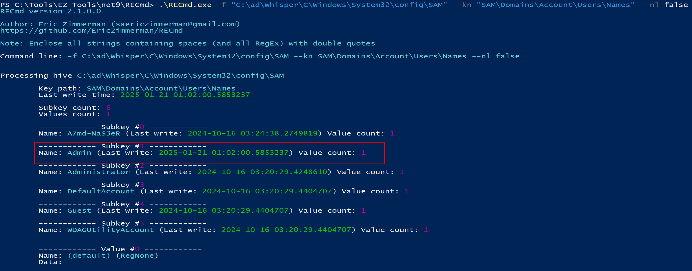

The value of the 4 last SID numbers are `1002`:

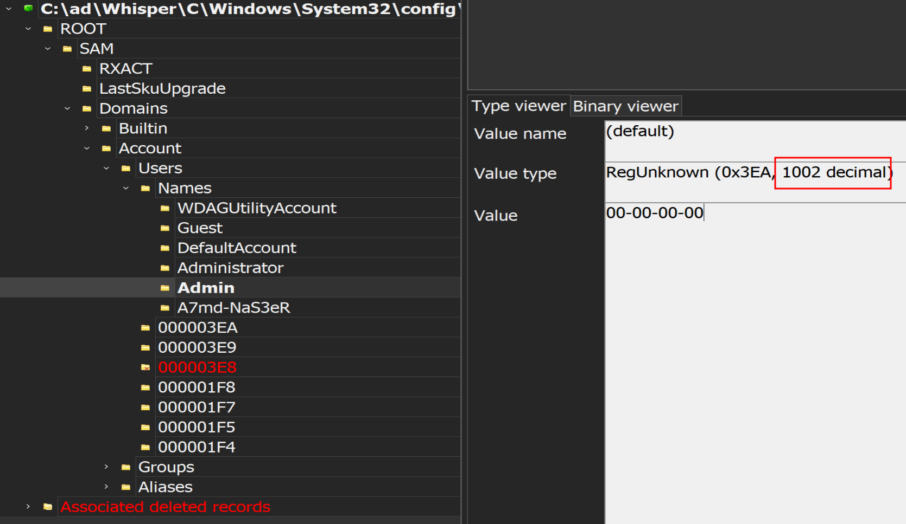

13. How many times has the newly created user logged in?

**Answer:** `0`

The entry `SAM\Domains\Account\Users` holds information about users:

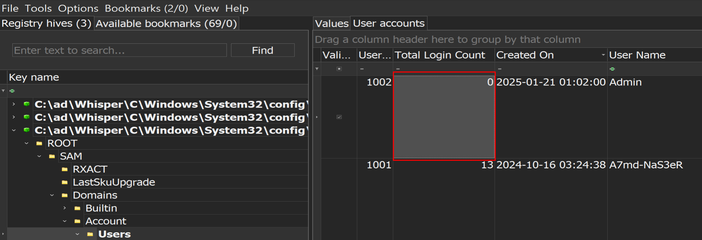

13. What is the password of the newly created user?

**Answer:** `Password123`

Mimikatz allows the dumping of the `SAM` registry where the password hashes are stored:

```cmd
mimikatz.exe "lsadump::sam /system:C:\ad\Whisper\C\Windows\System32\config\SYSTEM /sam:C:\ad\Whisper\C\Windows\System32\config\SAM" "exit"
```

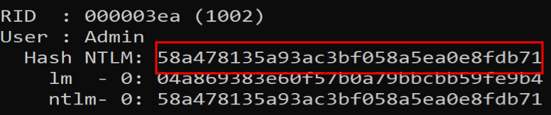

An online hash cracker returns the password:

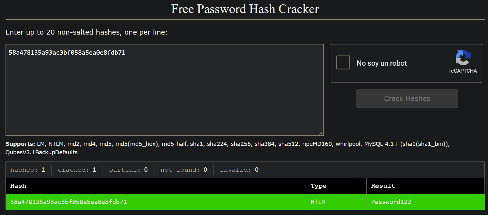